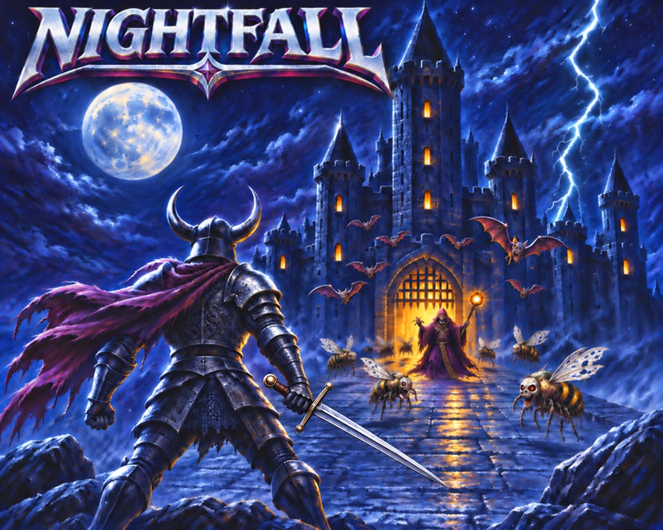

# Nightfall



Nightfall is an incremental survivor game for the BBC Micro series: patrol an endless scrolling world, cut down the horde and grind enough power to beat 3 shrine guardians. This repo holds the files to run the public beta and the [issue tracker](https://github.com/1larity/nightfall/issues). More about the game is on the [Nightfall page](https://evile.uk/redesign/projects/nightfall/).

The game project made considerable use of AI coding agents, all graphics are by the author, and the music is Holst's 'The Planets'.

## Play in your browser

[Play Nightfall in jsbeeb](https://bbc.xania.org/?model=Master&rom.3=github:1larity/nightfall/EGFX2.rom&rom.4=github:1larity/nightfall/EGFX.rom&rom.5=github:1larity/nightfall/EAUDIO.rom&rom.7=github:1larity/nightfall/NFASSETS.rom&disc1=github:1larity/nightfall/nightfall.ssd&autotype=*DISC%0A*RUN%20NFBOOT%0A). It takes about 30 seconds to reach the menu. Your players last until you reload the page, so use an emulator or your own machine to keep your progress.

## Run it yourself

| File | Master 128, Master Turbo, Master + 6502 Tube | BBC B with sideways RAM |
|---|---|---|
| `EGFX.rom` | slot 4 | slot 15 |
| `EGFX2.rom` | slot 3 | slot 13 |
| `EAUDIO.rom` | slot 5 | slot 5 |
| `NFASSETS.rom` | slot 7 | slot 7 |
| sideways RAM, left empty | slot 6 | slot 6 |
| BASIC | built in | slot 14 |
| DFS 0.90 | | slot 3 |

Slots 6 and 7 are fixed: the game keeps its world in slot 6 and looks for its sprites in slot 7. On a BBC B, EGFX must sit above DFS. A real Master has four banks of sideways RAM and Nightfall uses five banks, so one image needs a ROM cartridge or socket.

In [B-em](https://github.com/stardot/b-em), pick your machine from the Model menu, fit the ROMs from the ROM menu and load `nightfall.ssd` from the Disc menu. Then type:

```
*DISC
*RUN NFBOOT
```

Nightfall saves to its disc, so if the disc is write protected it tells you when it starts and waits while you turn protection off. BeebEm protects discs as it loads them: turn off Write Protect on Load on the File menu before loading the disc. In b2, fit the ROM images as ROMs rather than writeable banks, and leave only slot 6 writeable.

Your players are saved on the disc, so keep it writable and hang on to your copy: the disc from a later release starts fresh.

`SHA256SUMS` lists the checksum of each file.

## Keys

Main menu: **Space** starts a run, **H** opens Help, **P** opens players, **U** opens the upgrade shop.

In-game: **WASD** moves, **M** opens the world map, **Escape** pauses.

## Tested on

- B-em built from source (commit a76c365): Master 128, Master Turbo, Master + 6502 Tube, BBC B
- BeebEm 4.19: Master 128, Master + 65C02 Tube, BBC B
- b2 (20260322): Master 128, Master Turbo
- jsbeeb: Master 128

BeebEm and b2 are the Windows builds, tested under Wine. Nothing has run on real hardware yet, so reports from real machines are very welcome.

## Reporting a problem

[Raise an issue](https://github.com/1larity/nightfall/issues/new/choose) and include the version line from the bottom of the main menu.

## Roadmap

Beta 1 is the Barbarian and the first world. Next comes the gem store, where you buy new character archetypes, then Worlds 2 to 4, for four environments in all, each with new enemies and bosses.

## Licences

Copyright (c) 2026 Richard Beech. `nightfall.ssd` and `NFASSETS.rom` are CC BY-NC-SA 4.0 ([LICENSE](LICENSE)). `EGFX.rom` and `EGFX2.rom` are MIT ([LICENSE-EGFX](LICENSE-EGFX)). `EAUDIO.rom` is MIT ([LICENSE-EAUDIO](LICENSE-EAUDIO)).
